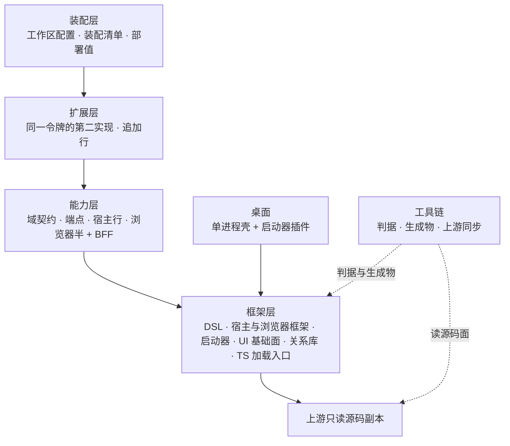
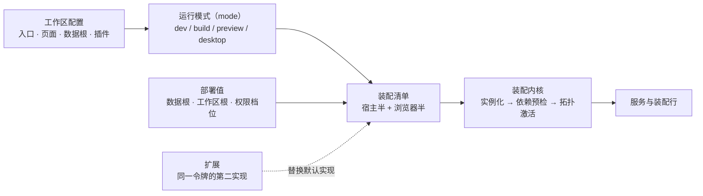
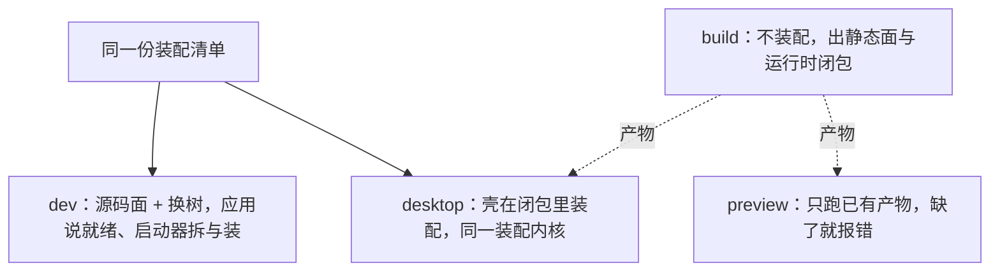

# 系统设计（分层、装配链与跨层不变量）

状态：已实现——门禁是包级 vitest + `just audit` / `just lint` / `just build`（组装用 `just custom build`），五层各有层设计与层判据。
范围：仓库级决定、层与依赖方向、装配链、运行形态、与上游的关系、跨层不变量、层索引与验收判据。单层的职责、术语与上游面在各层设计里。
非目标：单层实现细节与单层术语（层设计的 home）；上游内部结构（真源见[上游同步技能](../skills/zephyr-upstream-sync/SKILL.md)）。
关联：[定义权地图](../GLOSSARY-MAP.md) · [根规范](../standards/README.md) · [仓库约定](../../AGENTS.md) · [记录树布局](../README.md)

## 一、决定（仓库级）

| #   | 议题       | 决定                                                                                                | 一句话理由                                             |
| --- | ---------- | --------------------------------------------------------------------------------------------------- | ------------------------------------------------------ |
| 1   | 目录分组   | 包按家族两级分目录；家族是目录与分层，**不等于**上下文                                              | 上下文按定义权划分，见[定义权地图](../GLOSSARY-MAP.md) |
| 2   | 分层       | 框架 → 能力 → 扩展 → 装配；桌面与工具链是旁路                                                       | 替换实现依赖默认实现，反之不成立                       |
| 3   | 装配单位   | 装配清单，没有容器；数组顺序即装配顺序                                                              | 顺序是唯一的隐式契约，写在一处才读得出来               |
| 4   | 配置面     | 工作区根的配置文件是唯一配置面，包清单里的同名字段不参与配置                                        | 一份配置一个 home                                      |
| 5   | 启动器     | 三条核心命令（dev / build / preview）永远存在，插件只追加命令                                       | 「为什么这台机器没有 build」不该靠读配置回答           |
| 6   | 生命周期   | 应用入口只交清单；装配、重载、端口与退出码归启动器                                                  | 同一份清单被四种运行形态复用，差别只在部署值           |
| 7   | 上游       | 上游是按版本锁定的只读源码副本，只消费源码面                                                        | 不构建、不发布上游；本地 patch 只改工作树，失败即信号  |
| 8   | 新能力落点 | 域语义 → 能力层；只换某份默认实现 → 扩展层；只聚合给前端 → BFF；只改命令或打包 → 启动器插件或工具链 | 落点错了，能力就有两个 owner                           |
| 9   | 记录与词   | 事实按层登记，词由定义它的包持有，别处只引用                                                        | 一个事实一个 home；一个概念一个定义者                  |

## 二、分层与依赖

结论：依赖只向下，反向 import 即错；桌面与工具链不在这条链上，前者依赖框架层，后者判所有层。

## 三、装配链

结论：工作区配置给出入口与运行模式，模式与部署值一起收成两份装配清单，装配内核把清单变成服务与行。

## 四、运行形态

结论：四种形态共用同一份清单与同一个装配内核，差别只有装配根、数据根与产物是否存在。

## 五、与上游的关系

结论：上游只读、按版本锁定，本仓只消费源码面；改上游只能走同步链路（步骤清单加执行器）。

上游概念的词只在上游真源与层设计的「与上游的关系」一节出现；本仓的说法是：运行模式（mode）、装配清单、装配行、扩展、宿主装配面、工作区配置、部署值。

## 六、跨层不变量

1. **依赖只向下**：装配 → 扩展 → 能力 → 框架 → 上游；反向 import 即错。判据：`just audit` 的面边界与扩展边界两项。
2. **上游只读**：上游副本与依赖目录不手改，改上游只走同步链路。判据：`git status vendor/` 为空。
3. **上游知识的落点**：上游类型、字符串标识与私有字段名只出现在适配行；同一上游包的同一个面只有一个本地 owner（框架层豁免）。判据：`just audit` 的上游包唯一化。
4. **一个能力一个 owner**：同一服务令牌只在一处装配，重复注册直接抛；新能力按决定 8 判落点。
5. **一个概念一个定义者**：词由定义它的包持有，别处只引用；一个事实只有一个 home。判据：[定义权地图](../GLOSSARY-MAP.md) 的每行都有定义者。

## 七、层索引

| 层       | 包（模块）                                                                 | 拥有（一句）                                 | 不拥有（一句）               | 层设计                                                                                                                   |
| -------- | -------------------------------------------------------------------------- | -------------------------------------------- | ---------------------------- | ------------------------------------------------------------------------------------------------------------------------ |
| 框架层   | zephyr · zephyr-app · zephyr-cli · zephyr-ui · zephyr-rdb · TS 加载入口    | 不认识任何域的机制与装配内核                 | 域概念、装配清单内容、部署值 | [框架层](../../packages/zephyr/.agents/designs/20261113-框架层.md)                                                       |
| 能力层   | 域能力包（每域一个）· 对话域 BFF                                           | 每域契约、端点、宿主行与浏览器半；BFF 只聚合 | 别的域能力、扩展、清单       | [能力层](../../packages/agent/.agents/designs/20261113-能力层.md)                                                        |
| 扩展层   | better-session · session-mode · configurable-sandbox · agent-use           | 同一令牌的第二实现与追加行                   | 契约、默认实现、装不装       | [扩展层](../../packages/agent-ex/.agents/designs/20261113-扩展层.md)                                                     |
| 装配层   | 示例工作区应用                                                             | 工作区配置、两份装配清单、部署值             | 生命周期、装配机制           | [装配层](../../apps/zephyr-custom/.agents/designs/20261113-装配层.md)                                                    |
| 工具链层 | audit · dts-prepare · typert-generator · tsdown-plugin-cordis · 同步执行器 | 判据、生成物、构建期清单写回                 | 产品行为与发布面             | [工具链层](../../devpackages/.agents/designs/20261113-工具链层.md)                                                       |
| 桌面     | 单进程壳 · 启动器插件                                                      | 桌面命令与单进程壳                           | 核心三命令、业务行           | [桌面两包与单进程壳](../../packages/zephyr-desktop/zephyr-desktop-bundle/.agents/designs/20261110-桌面两包与单进程壳.md) |
| 上游     | 只读源码副本                                                               | 版本锁定的源码面                             | 任何本仓行为                 | [上游同步技能](../skills/zephyr-upstream-sync/SKILL.md)                                                                  |

## 八、验收判据

| #   | 判据（Done when）                                         | 命令                                                           | 层设计入口                                                            |
| --- | --------------------------------------------------------- | -------------------------------------------------------------- | --------------------------------------------------------------------- |
| 1   | 依赖方向、上游包唯一化、扩展边界成立                      | `just audit`                                                   | [工具链层](../../devpackages/.agents/designs/20261113-工具链层.md)    |
| 2   | 全仓类型与风格                                            | `just lint`                                                    | 各层规范                                                              |
| 3   | 框架层：装配内核、启动器、桌面链路                        | `pnpm exec vitest run packages/zephyr packages/zephyr-desktop` | [框架层](../../packages/zephyr/.agents/designs/20261113-框架层.md)    |
| 4   | 能力层：上游归属唯一、BFF 只聚合                          | `pnpm exec vitest run packages/agent`                          | [能力层](../../packages/agent/.agents/designs/20261113-能力层.md)     |
| 5   | 扩展层：同一令牌二选一、入口纪律                          | `pnpm exec vitest run packages/agent-ex`                       | [扩展层](../../packages/agent-ex/.agents/designs/20261113-扩展层.md)  |
| 6   | 装配层：示例工作区能构建（静态面 + 运行时闭包），清单可读 | `just custom build` + 清单评审                                 | [装配层](../../apps/zephyr-custom/.agents/designs/20261113-装配层.md) |
| 7   | 工具链层：判据与生成物可复现                              | `just audit`、`just vendor vendor-check`                       | [工具链层](../../devpackages/.agents/designs/20261113-工具链层.md)    |
| 8   | 文档与记录：相对链接可达、行内路径存在、术语有定义者      | `pnpm exec oxfmt --check .` + 评审人工                         | [根规范](../standards/README.md)                                      |
