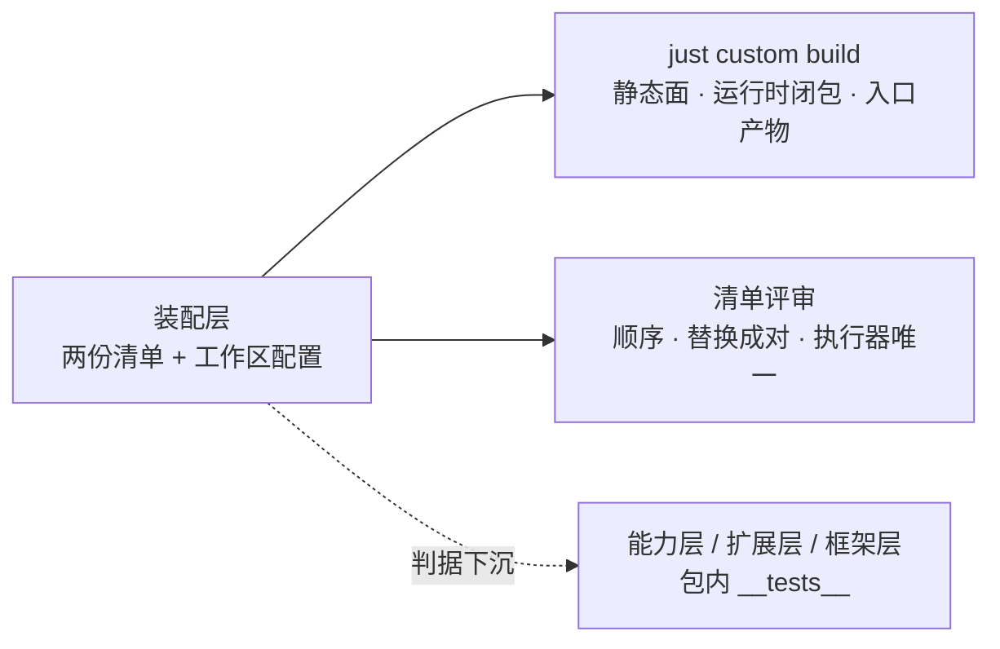

# 整装测试的分层与生命周期

状态：已生效——装配层不设测试门禁；组装由「能构建 + 清单可读」判，行为判据归能力层与扩展包的 `__tests__`。
范围：测试门禁落在哪一层、装配层为什么不承担、以「真后端 + vite dev server + happy-dom」形态整批跑的生命周期为什么不能当门禁、以及各条判据的落点。
非目标：各包内测试怎么写（归各包 `.agents/standards`）；`just test` 的收集规则（根 `vitest.config.ts`）；启动器四阶段（[框架层](../../../../packages/zephyr/.agents/designs/20261113-框架层.md)）；装配层职责本身（[装配层](./20261113-装配层.md)）。
关联：[应用 README](../../README.md) · [装配层](./20261113-装配层.md) · [如何验证](../../../../.agents/standards/how-to-verify.md) · [根 justfile](../../../../justfile)。

## 一、层职责与依赖

结论：判据跟着**能力**走——每层只验自己拥有的行为；装配层只验「组装能构建、清单可读」。

| 层（home）                    | 验什么                                                  | 入口                                                     |
| ----------------------------- | ------------------------------------------------------- | -------------------------------------------------------- |
| 框架层 `packages/zephyr/**`   | 装配内核、渲染骨架（slots / mount）、mux 与 stream 载具 | 包内 `__tests__`；`pnpm exec vitest run packages/zephyr` |
| 能力层 `packages/agent/**`    | 域内行为、宿主端点（wire 两种口径）、域装配             | 包内 `__tests__`                                         |
| 扩展层 `packages/agent-ex/**` | 第二实现与替换面、宿主端点、配置面                      | 包内 `__tests__`                                         |
| 装配层 `apps/zephyr-custom`   | 组装能构建；清单可读（顺序、替换成对、执行器唯一）      | `just custom build` + 清单评审                           |

判据的方向是**单向**的：包内测试不 import 应用的清单（`customProvidersOf`），应用也不重复包的行为断言。

## 二、拥有与不拥有（模块级）

结论：装配层拥有「装什么、按什么顺序、替换谁」；一行内部的行为、以及真服务的进程生命周期，都不在它手里。

| 模块                                                      | 拥有（职责与不变量）                                                             | 不拥有（明确排除）                     | 依赖方向                   | 接缝 / 适配器                                                                                        |
| --------------------------------------------------------- | -------------------------------------------------------------------------------- | -------------------------------------- | -------------------------- | ---------------------------------------------------------------------------------------------------- |
| 两份装配清单（`zephyr.provide.ts` / `client.provide.ts`） | 装哪些行、顺序（依赖方在前）、替换与剔除成对（`without` + 第二实现）、执行器唯一 | 行内部行为与其失败模式                 | 装配层 → 能力/扩展/框架    | 行的契约令牌；测试穿包内契约，不穿应用的清单                                                         |
| 组装验证（`just custom build` + 清单评审）                | 组装能构建（静态面 / 运行时闭包 / 入口产物）、清单可读性                         | 行为判据、真后端与 vite 的进程生命周期 | 装配层 → 框架层 CLI 四阶段 | 构建产物（由 CLI 给出）；测试期没有接缝                                                              |
| 包内 `__tests__`（能力 / 扩展 / 框架）                    | 域内行为、端点 wire、替换面的单元语义                                            | 组合顺序、应用的部署值                 | 包 → 自己声明的上游面      | `bootstrapApplication({ providers })` + 假实现（内存 transport / fake `AppEnv` / fake `WebStartup`） |

## 三、术语定义权

结论：「测试门禁」「组装验证」「判据下沉」三个词的定义在本篇；行为类词（装配、替换面、载具）沿用各自包的术语表。

| 词       | 意思                                                                            | 定义权 |
| -------- | ------------------------------------------------------------------------------- | ------ |
| 测试门禁 | 合入前必须绿、失败即拦住改动的那道命令；CI 的 `just test` 与 `just lint` 是门禁 | 本篇   |
| 组装验证 | 装配层的验证方式：构建通过 + 清单评审；不跑行为断言                             | 本篇   |
| 判据下沉 | 某条判据的 owner 从装配层移到拥有该行为的包，由包内 `__tests__` 承担            | 本篇   |

## 四、与上游的关系

结论：上游没有「应用级集成测试」这一层，本仓的 wire 与端点判据也都在包内；装配层只吃上游包的出口。

| 上游概念（真源：`vendor/deepseek-harness/docs/architecture.md`） | 上游说的是什么            | 本层怎么用                                                                |
| ---------------------------------------------------------------- | ------------------------- | ------------------------------------------------------------------------- |
| bundle / profile                                                 | 命名组合与其补丁          | 装配层就是一份组合；组合的正确性由「能构建」判                            |
| 端点（endpoint）与 remote 方法                                   | 宿主侧实现 + 浏览器侧转发 | 端点判据在拥有该端点的包内（`session/*`、`skill/*`、`workspace/*`）       |
| 工具执行器（executor）                                           | 决定模型面形状的独立插件  | 「只装一个执行器」是清单事实，由评审判；执行器选择语义归 `dsh-agent-loop` |

## 五、验收判据

结论：四条可判定，全部不依赖真后端、vite dev server 或浏览器。

| #   | 判据（Done when）                                | 命令                                                   | 检查点                                |
| --- | ------------------------------------------------ | ------------------------------------------------------ | ------------------------------------- |
| 1   | 示例工作区能构建                                 | `just custom build`                                    | 产物流水线四阶段全过                  |
| 2   | 装配层不收集任何测试                             | `pnpm exec vitest list --filesOnly apps/zephyr-custom` | 退出码 1 且打印 `No test files found` |
| 3   | 清单可读：每段装什么、依赖方在前、替换与剔除成对 | —                                                      | 评审人工（逐段读两份清单）            |
| 4   | 全仓门禁不含装配层                               | `just test` / `just lint`                              | 收集范围里没有 `apps/`                |

### 判据的落点

结论：绝大多数判据在包内已有同等覆盖；下表只列**缺**与**部分**，由对应包的 owner 补齐（装配层不补）。

| 判据（原在装配层）                                                                                                                   | 落点                                                                            | 现状                                                          |
| ------------------------------------------------------------------------------------------------------------------------------------ | ------------------------------------------------------------------------------- | ------------------------------------------------------------- |
| `provideShell` 装上游两份实现、`resolveExecutable` 真解析、shell 环境注册表登记 / 枚举 / 键冲突 / 注销、`ShellExecutor` 只声明不实现 | `packages/agent/dsh-shell/src/__tests__/`                                       | **缺**（该包 0 个 spec）                                      |
| 沙箱替换接缝：`without(SandboxDefault)` / `without(FsSandbox)` 后两令牌由本包兑现；只剔一个仍由官方兑现；本包每行可被 `without` 定位 | `packages/agent-ex/configurable-sandbox/src/__tests__/assembly.spec.ts`         | **缺**（包内 6 个 spec 是解析 / 文本 / 方言，无装配）         |
| 经 `FileSystem` 接口的拒绝 / 只读 / 额外可写根语义                                                                                   | `packages/agent-ex/configurable-sandbox/src/__tests__/file-system.spec.ts`      | **部分**（`containment.spec` 只测 `isPathUnder`）             |
| 运行时策略文本的接管时机（agent 第一次装配就是本包文本）                                                                             | `packages/agent-ex/configurable-sandbox/src/__tests__/runtime-contexts.spec.ts` | **缺**（`policy-text.spec` 只测文本生成与上下文名）           |
| `session/selectModel` 真行为（选完读回会话自己的 agent）                                                                             | `packages/agent/dsh-skill/src/__tests__/session-endpoints.spec.ts`              | **部分**（`modelCatalog` 已是真行为；`selectModel` 是弱断言） |
| PTC 执行器被选上（模型面只有 `run_code`）                                                                                            | `packages/agent/dsh-agent-loop/src/__tests__/`                                  | **缺**（执行器选择的互斥面）                                  |

已在包内有同等判据、装配层不再重复的：装配拓扑的单元语义（`packages/zephyr/zephyr`）、`without` 剔除语义、`sessionQuery` 别名与 RDB 替换（`better-session`）、`Skill` 的 `list` / `get` / `snapshot` 面（`dsh-skill`）、端点行进 Module（`zephyr-app` 的装配完整性）、`deliverables` 装配、渲染冒烟与 `#root` 非空、slots 骨架、stream 载具、会话 binding 与 `retain`、`sessionReferenceResolver/candidates`。

### 批次

结论：先让门禁不再收集装配层，再按落点表逐个补包内判据；补判据的次序与包 owner 的节奏一致，互不阻塞。

| 批次 | 内容                                                                                | 判据                                                 |
| ---- | ----------------------------------------------------------------------------------- | ---------------------------------------------------- |
| 1    | 装配层的整装 spec 与 `test-apps` 入口退出；README 的验证节改成「组装验证」          | 第 2、4 条                                           |
| 2    | 落点表的**缺**项由对应包补（`dsh-shell`、`configurable-sandbox`、`dsh-agent-loop`） | 各包 `__tests__` 绿                                  |
| 3    | 落点表的**部分**项补齐（`file-system`、`selectModel`）                              | 同上                                                 |
| 4    | 若将来要真服务冒烟：按第六节的门槛重开，不进默认门禁                                | 单 spec 上限、整批上限、端口/数据根隔离、vite 能关闭 |

## 六、取舍与未定

结论：用「构建 + 评审」换掉装配层的测试门禁，代价是组合类缺陷要靠评审与手测兜；门槛写在这里，恢复时按它判。

- 代价：清单顺序、替换成对这类组合缺陷没有机械判据（第 3、4 条靠评审）；`just custom build` 只证明装得起来，不证明跑得对。
- 真服务形态的生命周期不可控，所以它不能进门禁：每次装配都会起一份 vite dev server（`ViteHandoffDefault` 的 `onInit`），而它的 `dispose` 只清引用、不关闭 dev server 与 watcher；HTTP 端口来自进程环境（`WebStartupDefault` 构造期读 `process.env.PORT`，缺省 3080），同一进程里的多次装配共享这个开关；`WebServerDefault` 的 `onDispose` 用 `server.close(cb)`，客户端半还握着 socket 时收不干。累积起来的表现是「卡住不返回」，不是「红」。
- 恢复真服务门禁的门槛（三条都满足才谈）：单 spec 上限与整批上限写进配置并带硬超时；每次装配用独立随机端口与独立临时数据根；装配结束时能关闭 vite dev server 与其 watcher。
- 未定：`selectModel` 与 PTC 执行器选择两条判据要不要由包 owner 补；补齐之前它们是装配层的已知缺口。
