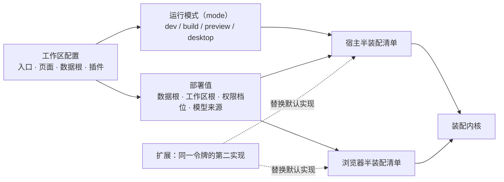

# 装配层（`apps/zephyr-custom`：工作区配置、装配清单与部署值）

状态：已实现——清单、工作区配置与部署值即当前代码；`just custom build` 能构建，本层**不设测试门禁**。
范围：装配面拥有什么——宿主半与浏览器半两份装配清单、工作区配置、部署值与部署环境读点；以及它不拥有的生命周期与装配机制。
非目标：各域行怎么装（归各包的域装配函数）；启动器四阶段（[框架层](../../../../packages/zephyr/.agents/designs/20261113-框架层.md)）；扩展的域内行为（[扩展层](../../../../packages/agent-ex/.agents/designs/20261113-扩展层.md)）。
关联：[应用 README](../../README.md) · [系统设计](../../../../.agents/designs/20260917-系统设计.md) · [定义权地图](../../../../.agents/GLOSSARY-MAP.md) · [如何写](../../../../.agents/standards/how-to-write.md)

## 一、层职责与依赖

结论：装配面只交两份清单与一组部署值；装配、重载、端口与退出码归框架层的启动器。

清单顺序即装配顺序：依赖方在前，同一段里的跨包理由写在清单旁。工作区配置是唯一配置面，`package.json` 的 `dsh` 段不参与配置。

## 二、拥有与不拥有（模块级）

| 模块             | 拥有（职责与不变量）                                                                                                               | 不拥有（明确排除）                     |
| ---------------- | ---------------------------------------------------------------------------------------------------------------------------------- | -------------------------------------- |
| 宿主半装配清单   | 装哪些行、按什么顺序装、哪一段装什么（认凭据 → 框架链 → 存储 → 会话 → agent → 会话模式 → 环境面 → 任务与工作区 → 工具面 → 部署值） | 行内部的形状与默认值；生命周期         |
| 浏览器半装配清单 | 连接与端点先单装，随后链 → 主题 → 布局，再按域追加界面行                                                                           | 装配机制；域内界面实现                 |
| 工作区配置       | 入口、页面、解析规则、桌面身份、数据根、插件清单                                                                                   | 命令清单（三核心命令永远在）、产物路径 |
| 部署值与部署环境 | 只有装配面知道的值（数据根、工作区根、权限档位、模型来源）；唯一的环境读点                                                         | 包里读环境变量；第二处路径拼接         |
| 换树就绪判据     | 什么时候可以换树（应用侧的决定）                                                                                                   | 拆树与起树（归启动器）                 |

## 三、术语定义权

结论：装配面持有「本部署装什么」的说法；装配机制的语汇仍归框架层。

| 概念                                         | 定义者                                                                               | 其他层怎么引用                                       |
| -------------------------------------------- | ------------------------------------------------------------------------------------ | ---------------------------------------------------- |
| 部署值、宿主装配面、补洞行（本部署不写）     | 本层（本文为定义处）                                                                 | 包只读部署值的只读面，不读环境、不猜数据根           |
| 装配清单 / 装配行 / 域装配函数 / feature     | [框架层 `zephyr`](../../../../packages/zephyr/zephyr/.agents/GLOSSARY.md)            | 本层只写清单内容与顺序                               |
| 运行模式（mode）、工作区配置的字段与解析规则 | `zephyr-cli`（框架层）                                                               | 本层只写本部署那一份配置内容，并按模式取入口与部署值 |
| 会话编辑组 / 会话管理组                      | [`better-session`](../../../../packages/agent-ex/better-session/.agents/GLOSSARY.md) | 本层只决定装它还是装默认实现                         |

## 四、与上游的关系

结论：本层只有一份组合（两份清单），没有上游意义上的「多组合选择面」；上游包只有被源码 import 或按字符串点名的才由本层声明，其余由提供方声明。

| 上游概念（真源：`vendor/deepseek-harness/docs/architecture.md`） | 上游说的是什么                           | 本层怎么用                                                   |
| ---------------------------------------------------------------- | ---------------------------------------- | ------------------------------------------------------------ |
| 命名组合（上游叫 profile）                                       | 一份命名组合，列出叠加的 bundle 与其补丁 | 本部署只有一份组合，写在两份清单里；运行模式只切入口与部署值 |
| bundle / bundle patch                                            | 行清单的分发格式与叠加上去的补丁         | 本层不读补丁文件；替换与取舍由 feature（配置 / 剔除）表达    |
| 行的配置覆盖                                                     | 按行 id 替换整份配置                     | 本层用配置 feature 给部署值，不改行内部默认值                |

## 五、验收判据

**本层不承担测试门禁**：组装对不对用「能构建 + 清单可读」判，行为判据下沉到能力层与扩展包的 `__tests__`（分层与落点见[整装测试的分层与生命周期](./20261113-整装测试的分层与生命周期.md)）。

| #   | 判据（Done when）                                          | 命令                | 检查点                             |
| --- | ---------------------------------------------------------- | ------------------- | ---------------------------------- |
| 1   | 示例工作区能构建（静态面 + 运行时闭包 + 入口产物）         | `just custom build` | 产物落在工作区的产物根             |
| 2   | 清单可读：每段装什么、依赖方在前、跨段理由有注释           | —                   | 评审人工（对着清单逐段读）         |
| 3   | 同一令牌二选一在清单里成立（替换与剔除成对，不留悬空注入） | —                   | 评审人工；替换规则本身有包级用例   |
| 4   | 执行器只有一个（本部署选程序化工具调用）                   | —                   | 评审人工（清单里只装一个执行器行） |
| 5   | 全仓类型与风格                                             | `just lint`         | —                                  |

## 六、取舍与未定

- 清单写在应用里，不生成装配物：生成物会与清单形成两份真源，代价是应用自己维护顺序。
- 配置只有工作区配置一份：与 `package.json` 的 `dsh` 段并存时，改动会在两处漂移。
- 插件以内联展开的清单条目出现：装的什么、命令从哪来，一眼看得到。
- 不写补洞行：补洞行把「域没装」伪装成已装。
- 未定：两个环境开关（权限档位、打包形态）现在直接读进程环境，要不要收进运行模式值；清单顺序没有机械判据，靠第 2 条的评审兜。
