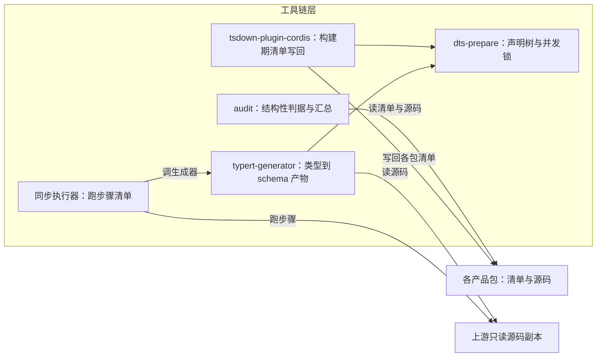

# 工具链层（`devpackages/*` 与上游同步执行器）

状态：已实现——`just audit` 逐包判据加根上汇总，`just prepare` 走完同步 / 打补丁 / 预构建；四个包都不发布。
范围：判据工具、声明树、类型产物生成器、构建期清单写回与上游同步执行器各拥有什么、谁调用谁、与上游只读源码副本的关系、层判据。
非目标：判据内容本身（面边界、声明未用、扩展边界的规则写在[如何写](../../../.agents/standards/how-to-write.md)）；同步流程与步骤语义（[上游同步技能](../../../.agents/skills/zephyr-upstream-sync/SKILL.md)）；上游内部结构。
关联：[系统设计](../../../.agents/designs/20260917-系统设计.md) · [定义权地图](../../../.agents/GLOSSARY-MAP.md) · [AST 合成 typert 产物](../../../devpackages/typert-generator/.agents/designs/20261016-AST合成typert产物.md)

## 一、层职责与依赖

结论：本层只出判据、生成物与构建期插件；产品包不 import 它，它也不进发布面。

审计的包列表不来自 pnpm 依赖图（循环依赖时它会拒跑），包列表单独拿；汇总器收到空输入即失败。

## 二、拥有与不拥有（模块级）

| 模块                     | 拥有（职责与不变量）                                                                         | 不拥有（明确排除）                               |
| ------------------------ | -------------------------------------------------------------------------------------------- | ------------------------------------------------ |
| `audit`                  | 逐包判据（面边界、声明未用、扩展边界）、跨包判据（上游包唯一化）与汇总；删未用依赖的一键写回 | 规范内容（判据语义的 home 是根规范）；构建与发布 |
| `dts-prepare`            | 全仓声明树的路径、生成与并发锁                                                               | 类型语义；产物内容                               |
| `typert-generator`       | 用 AST 合成三份类型产物、预演不写盘                                                          | 上游生成器的内部；wire 语义                      |
| `tsdown-plugin-cordis`   | 构建期配置合成、产物形态、清单写回（出口 / 发布态 / 引擎约束）                               | 各包的构建配置接入；声明生成；运行期联邦         |
| 同步执行器（住技能目录） | 跑步骤清单；步骤类型只有六种                                                                 | 步骤该做什么（数据在同步清单里）；上游语义       |

## 三、术语定义权

结论：判据名与生成物名归本层；「面边界」「声明未用」这类判据的语义仍是根规范的说法。

| 概念                                                | 定义者                                                                                                                        | 其他层怎么引用                                   |
| --------------------------------------------------- | ----------------------------------------------------------------------------------------------------------------------------- | ------------------------------------------------ |
| 面边界、上游包唯一化、声明未用、扩展边界            | `audit`（判据在[如何写](../../../.agents/standards/how-to-write.md)，实现在本包）                                             | 各层只说「按 `just audit` 的哪一项」，不重述规则 |
| 声明树、vendored 快照                               | 本层（`dts-prepare` 与同步清单）                                                                                              | 各包构建只调用，不自己生成                       |
| 步骤（git / text / rm / exports / typert / native） | 同步清单（真源在同步技能）                                                                                                    | 改上游只加步骤，不改执行器                       |
| 装配清单、出口、发布态清单                          | [框架层 `zephyr`](../../../packages/zephyr/zephyr/.agents/GLOSSARY.md) 与[如何写](../../../.agents/standards/how-to-write.md) | 本层只按已定的出口键推导，不新增语汇             |

## 四、与上游的关系

结论：本层是唯一允许写上游工作树的地方，且只经步骤清单；上游概念只在本表与上游真源里出现。

| 上游概念（真源：`vendor/deepseek-harness/docs/architecture.md`） | 上游说的是什么                 | 本层怎么用                                                |
| ---------------------------------------------------------------- | ------------------------------ | --------------------------------------------------------- |
| 命名组合 / bundle / bundle patch                                 | 组合与补丁叠加出的行清单       | 本仓不消费这套机制；只消费上游源码面                      |
| 上游的类型产物生成器                                             | 上游自己生成 schema 与反射产物 | 本仓用 AST 生成器替代那一步，产物落在上游源码树的固定出口 |
| 上游交付面与非产品面                                             | 上游仓里不随包发布的部分       | 同步步骤里删掉，不手工改                                  |

## 五、验收判据

| #   | 判据（Done when）                              | 命令                                                  | 包级 spec 入口                     |
| --- | ---------------------------------------------- | ----------------------------------------------------- | ---------------------------------- |
| 1   | 结构性判据在 CI 与本地同一条命令下判           | `just audit`                                          | `pnpm exec vitest run devpackages` |
| 2   | 上游知识只出现在适配行（一个上游包一个 owner） | `just audit`（上游包唯一化）                          | 同上                               |
| 3   | 声明树只有一个生成者                           | `just build`                                          | `pnpm exec vitest run devpackages` |
| 4   | 类型产物可由预演复现                           | `pnpm exec vitest run devpackages`                    | 同上                               |
| 5   | 上游工作树没被手改                             | `git status vendor/` 为空；`just vendor vendor-check` | —                                  |

## 六、取舍与未定

- 不把审计做进 lint：lint 判类型与规则，审计判结构与声明，红的原因不同。
- 不给每个工具链包都建记录树：规则多的那个才有 README 与设计，其余收在实现与根规范里。
- 不把同步执行器做成 workspace 包：它跟着技能换版，产品包不该依赖它。
- 不手工维护类型产物：产物由 AST 生成，手改会被下一次预构建覆盖。
- 未定：审计范围只覆盖产品包，工具链与装配面自己的声明未用无人判；类型产物的漂移没有「重新生成后无差异」的判据。
