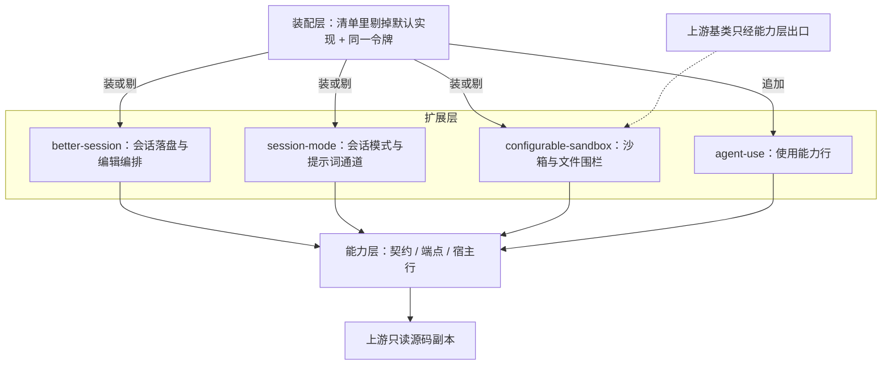

# 扩展层（`packages/agent-ex/*`：替换实现与追加行）

状态：已实现——四个包都是「同一令牌的第二个实现」或「追加行」；运行期零上游 import。
范围：本层怎么落在能力层的契约上、层内依赖方向、本层定义哪些词（别处怎么引用）、与上游的关系、层判据。
非目标：各扩展的域内行为（[`better-session`](../../better-session/README.md) / [`session-mode`](../../session-mode/README.md) / [`configurable-sandbox`](../../configurable-sandbox/.agents/designs/20261106-配置来源与替换形态.md) 各自的 README 与包级设计）；能力包与 BFF 的归类（见[能力层](../../../agent/.agents/designs/20261113-能力层.md)）。
关联：[系统设计](../../../../.agents/designs/20260917-系统设计.md) · [定义权地图](../../../../.agents/GLOSSARY-MAP.md) · [装配层](../../../../apps/zephyr-custom/.agents/designs/20261113-装配层.md) · [如何写](../../../../.agents/standards/how-to-write.md) 的「扩展边界」判据

## 一、层职责与依赖

结论：本层只做两件事——用同一令牌换掉默认实现，或往既有装配面追加行；装谁由装配层的清单决定。

四个扩展互不 import、互不声明运行期依赖；要上游基类时经能力层的出口取。

## 二、拥有与不拥有（模块级）

| 模块                                                  | 拥有（职责与不变量）                         | 不拥有（明确排除）                         |
| ----------------------------------------------------- | -------------------------------------------- | ------------------------------------------ |
| 替换实现（`better-session` / `configurable-sandbox`） | 同一令牌的第二个实现；按需接管上游基类的行为 | 契约本身、默认实现、装配顺序、装不装的开关 |
| 追加行（`session-mode` / `agent-use`）                | 往既有槽位与工具注册表追加行                 | 领域能力、清单来源                         |
| 两层结构（`configurable-sandbox`）                    | 内层保留上游基类行为，外层可被清单位置定位   | 规则判定（内层）、装配（外层）             |

## 三、术语定义权

结论：编辑语义归 `better-session`，会话模式语汇归 `session-mode`；能力层与界面层只用这些词，不另立同义词。

| 概念                                                           | 定义者                                                                                                      | 其他层怎么引用                                             |
| -------------------------------------------------------------- | ----------------------------------------------------------------------------------------------------------- | ---------------------------------------------------------- |
| 就地编辑 / 撤回 / 分支 / seed / 重放 / 会话编辑组 / 会话管理组 | [`better-session` 术语表](../../better-session/.agents/GLOSSARY.md)                                         | 会话界面按它写按钮与端点调用，不直读库表；能力层只提供令牌 |
| 会话模式、工具说明分组、提示词通道                             | `session-mode`（[设计](../../session-mode/.agents/designs/20260928-preset平面与模式收口.md)）               | 界面与装配面按模式取值；不把模式说成「换一份行清单」       |
| 可配置沙箱、访问规则、拒绝项                                   | `configurable-sandbox`（[设计](../../configurable-sandbox/.agents/designs/20261106-配置来源与替换形态.md)） | 装配面只给规则来源；工具行与宿主不解析规则                 |
| 会话数据面的词（会话 / 轮次 / 闭合边界 / live 与 cold）        | [能力层的 `dsh-session`](../../../agent/dsh-session/.agents/GLOSSARY.md)                                    | 本层的替换实现按它落盘与读面，只引用                       |

## 四、与上游的关系

结论：本层运行期零上游 import；上游基类与上游行一律经能力层出口取，上游的概念只在本表出现。

| 上游概念（真源：`vendor/deepseek-harness/docs/architecture.md`） | 上游说的是什么                        | 本层怎么用                                                                         |
| ---------------------------------------------------------------- | ------------------------------------- | ---------------------------------------------------------------------------------- |
| agent preset / roster                                            | 一份行清单 + 会话空白期换清单的选择面 | 本部署只有一份行清单（写在工作区配置里），不做选择面；会话模式是它之上的会话级收口 |
| 上游沙箱与文件围栏                                               | 进程沙箱与文件访问策略                | 内层继承上游基类行为（经能力层出口），外层叠加访问规则                             |
| 上游存储 domain                                                  | 存储后端与域路由                      | 换上 RDB 实现，同一批令牌，装配面二选一                                            |
| 上游工具与技能行                                                 | 工具注册表与技能目录                  | 只追加行，不改上游行的行为                                                         |

## 五、验收判据

| #   | 判据（Done when）                                        | 命令                                    | 包级 spec 入口                           |
| --- | -------------------------------------------------------- | --------------------------------------- | ---------------------------------------- |
| 1   | 扩展入口纪律（只许引契约 / 测试 / 端点面）与扩展间零依赖 | `just audit`（扩展边界）                | `pnpm exec vitest run packages/agent-ex` |
| 2   | 运行期与测试面都不声明上游依赖                           | `just audit`（声明未用 + 上游包唯一化） | 同上                                     |
| 3   | 同一令牌二选一在装配面成立，替换不漏行、不留悬空注入     | 清单评审（替换与剔除成对）              | `pnpm exec vitest run packages/agent-ex` |
| 4   | 层回归                                                   | `just lint`                             | `pnpm exec vitest run packages/agent-ex` |

## 六、取舍与未定

- 不 fork 默认实现：继承加覆盖，上游一改只跟着改覆盖点。
- 不给扩展加开关：装与不装由装配层的清单决定。
- 不让扩展互引：否则谁先谁后成了隐式约定。
- 未定：`configurable-sandbox` 还没进本部署清单（只有装配面用例与 e2e 支撑脚本装它）；扩展边界判据暂不豁免测试代码，见[债](../debts/20261113-扩展边界判据未豁免测试里的server宿主行.md)。
