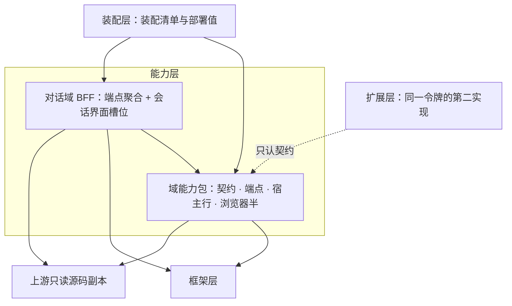

# 能力层（`packages/agent/*`：域能力包与 BFF）

状态：已实现——一个上游包在一个本地面只有一个 owner；域能力包与唯一 BFF 的分工即当前代码。
范围：域能力包与 BFF 各拥有什么、层内四块职能与依赖方向、本层定义哪些词（别处怎么引用）、与上游的关系、层判据。
非目标：上游包逐个归属与同名符号处置（[上游依赖的 owner 拓扑](./20261109-上游依赖的owner拓扑.md)）；三类包归类与槽位归属（[核心能力与 BFF 分层](./20261109-核心能力与BFF分层.md)）；包内的面与写法（[包内子域拆分与注册抽象](./20261028-包内子域拆分与注册抽象.md)）。
关联：[系统设计](../../../../.agents/designs/20260917-系统设计.md) · [定义权地图](../../../../.agents/GLOSSARY-MAP.md) · [框架层](../../../zephyr/.agents/designs/20261113-框架层.md) · [扩展层](../../../agent-ex/.agents/designs/20261113-扩展层.md)

## 一、层职责与依赖

结论：本层按「一个域一个包」提供契约、端点、宿主行与浏览器半；BFF 只为本场景聚合端点与界面槽位，不持有领域能力。

## 二、拥有与不拥有（模块级）

| 模块                   | 拥有（职责与不变量）                                                           | 不拥有（明确排除）                                      |
| ---------------------- | ------------------------------------------------------------------------------ | ------------------------------------------------------- |
| 域能力包（每个域一个） | 本域契约（词与纯函数）、端点 wire 形状、宿主行、浏览器半；本域的上游面         | 别的域的上游包；扩展层；装配清单与部署值                |
| BFF（对话域）          | 本场景的端点聚合（会话组 / 会话引用 / 文件引用 / 日程 / 交付物）与会话界面槽位 | 会话存储 / 查询 / 投影 / 权限 / 上传 / 工作区的领域能力 |
| 无本域契约的行包       | 一条指令行、一行服务加一套上游工具与界面、设置文档的加载与端点                 | 能力名、领域状态、可注入的领域能力                      |

## 三、术语定义权

结论：域里的词由该域的包定义；会话数据面的词只有 `dsh-session` 一个定义者，BFF 与界面只引用。

| 概念                                                              | 定义者                                                           | 其他层怎么引用                                                               |
| ----------------------------------------------------------------- | ---------------------------------------------------------------- | ---------------------------------------------------------------------------- |
| 会话 / 轮次 / 闭合边界 / ignorable 事件 / 版本效果 / live 与 cold | [`dsh-session` 术语表](../../dsh-session/.agents/GLOSSARY.md)    | 持久化实现方按它写落盘与读面；编辑语义的实现方（扩展层）引用；会话界面只引用 |
| 存储 hub 与 domain                                                | `dsh-storage`（契约面）                                          | 持久化实现方与 BFF 引用，不自造第二套                                        |
| 沙箱、文件围栏、文件系统契约                                      | `dsh-sandbox` / `dsh-fs`                                         | 扩展层的可配置沙箱在它之上叠加规则；工具行经它执行                           |
| 工具注册表、技能目录、权限三面、上传面、工作区绑定                | 各自的域包                                                       | 只引用；跨域经本地包取，不经它背后的上游包                                   |
| 装配语汇（装配清单 / 装配行 / 域装配函数）                        | [`zephyr`（框架层）](../../../zephyr/zephyr/.agents/GLOSSARY.md) | 本层只写自己的域装配函数，不改写语汇                                         |

## 四、与上游的关系

结论：本层以上游适配行为主，上游知识只落在本包的适配面上；跨包消费只认契约与端点出口。

| 上游概念（真源：`vendor/deepseek-harness/docs/`）           | 上游说的是什么                    | 本层怎么用                                                       |
| ----------------------------------------------------------- | --------------------------------- | ---------------------------------------------------------------- |
| 会话与事件日志（`subsystems/session.md`）                   | 会话 = 事件日志 + 投影            | `dsh-session` 用本地契约承接，读写面留在本层                     |
| agent preset 与可换 roster（`architecture.md`）             | 一份行清单 + 会话级换清单的选择面 | 契约只留 preset 投影，不实现选择面；会话级收口归扩展层的会话模式 |
| 工具 / 技能 / 沙箱 / 权限各自的上游行（`subsystems/`）      | 各域发布服务与工具                | 每域一个适配行接管，上游标识不出本包                             |
| 装配清单（上游是 bundle + 补丁文件叠加，`architecture.md`） | 组合由若干层补丁叠出来            | 本层不读补丁文件；组合只在装配层                                 |

## 五、验收判据

| #   | 判据（Done when）                            | 命令                         | 包级 spec 入口                                         |
| --- | -------------------------------------------- | ---------------------------- | ------------------------------------------------------ |
| 1   | 一个上游包在一个本地面只有一个 owner         | `just audit`（上游包唯一化） | `pnpm exec vitest run packages/agent`                  |
| 2   | 上游知识没漏到消费侧：跨包只认契约与端点出口 | `just audit`                 | 同上                                                   |
| 3   | 能力层不 import 扩展层                       | `just audit`（扩展边界）     | 同上                                                   |
| 4   | BFF 的端点实现只调各域契约，不落领域判断     | `just audit` + 评审          | `pnpm exec vitest run packages/agent/dsh-conversation` |
| 5   | 层回归                                       | `just lint`                  | `pnpm exec vitest run packages/agent`                  |

## 六、取舍与未定

- 不建转发出口（`export *`）：同一份东西列两遍，上游结构一变就跟着改。
- 不给每个上游包建本地包：包数跟着上游涨，而多数上游包只服务一个场景。
- 不把上游实现类放进契约面：契约是「调用方要了解的事实」，不是实现长相。
- 未定：BFF 仍直接依赖多个上游包，与「BFF 只聚合」的判据冲突；判据与出路记在 [owner 拓扑](./20261109-上游依赖的owner拓扑.md) 第七、八节。
