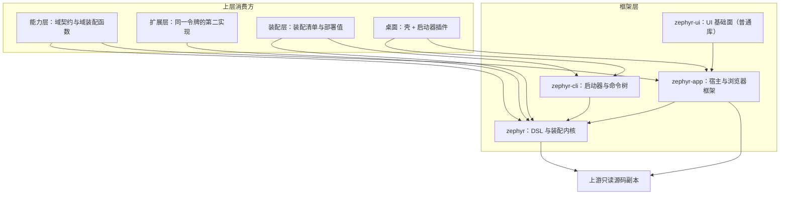

# 框架层（`zephyr` / `zephyr-app` / `zephyr-cli` / `zephyr-ui` / `zephyr-rdb` / TS 加载入口）

状态：已实现——六块的面、装配内核与启动链路即当前代码；层回归 `pnpm exec vitest run packages/zephyr packages/zephyr-desktop` 全绿。
范围：本层六块各拥有什么、层内依赖方向、本层定义哪些词（别处怎么引用）、与上游只读源码副本的关系、层判据。
非目标：包内实现细节（各包 `README.md` 与包级 `.agents/designs/`）；桌面两包的职责（只在依赖位置出现，见[桌面两包与单进程壳](../../../zephyr-desktop/zephyr-desktop-bundle/.agents/designs/20261110-桌面两包与单进程壳.md)）；上游内部结构（真源见[上游同步技能](../../../../.agents/skills/zephyr-upstream-sync/SKILL.md)）。
关联：[系统设计](../../../../.agents/designs/20260917-系统设计.md) · [定义权地图](../../../../.agents/GLOSSARY-MAP.md) · [包术语表](../../zephyr/.agents/GLOSSARY.md) · [如何写](../../../../.agents/standards/how-to-write.md)

## 一、层职责与依赖

结论：本层只放「谁都能用、且不认识任何域」的机制；上层只能经本层的出口与契约使用它，反向依赖即错。

`zephyr-rdb` 与 TS 加载入口不在依赖链上：零上游、零层内依赖，由装配层按需直接引用。

## 二、拥有与不拥有（模块级）

| 模块         | 拥有（职责与不变量）                                                                                           | 不拥有（明确排除）                           |
| ------------ | -------------------------------------------------------------------------------------------------------------- | -------------------------------------------- |
| `zephyr`     | 令牌与注入、装配清单、装配内核、域装配函数、适配行与行入口的类型与静态检查                                     | 任何领域概念；运行期语义（归 cordis）        |
| `zephyr-app` | 宿主与浏览器两半的框架面：服务端与页面的装配面、端点与流式通道、客户端模块与渲染骨架、环境契约、开发期换树信号 | 服务表（这份部署装哪些行）、装配清单、域行为 |
| `zephyr-cli` | 命令内核与四阶段、命令树、工作区配置解析、布局与数据根、构建编排、运行模式（mode）作为部署值                   | HMR 实现、上游适配、安装包与签名             |
| `zephyr-ui`  | 官方组件统一出口、布局原语、本套控件、按 schema 生成的行配置页、引用解析                                       | 任何域的槽位、数据与文案；装配行身份         |
| `zephyr-rdb` | 一份表定义驱动 DDL、迁移与类型化表句柄；方言只在装配处出现                                                     | 业务查询语义、ORM 关系映射、连接生命周期     |
| TS 加载入口  | 让 `node_modules` 下的 `.ts` 能被 Node 直接跑（ESM only）                                                      | 产品行为、构建、类型检查                     |

出口分工：`zephyr` 的包根两端共用——DSL 与装配内核是同一份，浏览器里 cordis 是合法运行期（框架的浏览器装配只是同一内核的入口），**不按运行环境分面**；`zephyr-app` 另出浏览器面 `@morlay/zephyr-app/client`，契约覆盖用的类型断言工具也在那儿。其他层的浏览器半按这两条取用，不引明确宿主专属的包根。

## 三、术语定义权

结论：装配语汇归 `zephyr`，界面语汇归 `zephyr-app` 与 `zephyr-ui`，运行形态语汇归 `zephyr-cli`；本层之外只用这些词，不另立同义词。

| 概念                                                                       | 定义者                                                    | 其他层怎么引用                                                   |
| -------------------------------------------------------------------------- | --------------------------------------------------------- | ---------------------------------------------------------------- |
| 令牌 / 注入 / 装配清单 / 装配行 / 装配内核 / 域装配函数 / feature / 适配行 | [`zephyr` 术语表](../../zephyr/.agents/GLOSSARY.md)       | 能力层与扩展层按同一批词写自己的域装配函数；装配层只写清单内容   |
| 界面模块（服务 + 位置 + 视图）、位置、视图、槽位、客户端模块               | `zephyr-app`（浏览器框架，设计与 README 为准）            | 能力层的浏览器半与扩展层的界面行只声明位置与视图                 |
| 配置页语汇（页读数 / 字段树 / 草稿 / 字段槽）                              | [`zephyr-ui` 术语表](../../zephyr-ui/.agents/GLOSSARY.md) | 设置面与各域只引用，不重定义                                     |
| 运行模式（mode）、工作区配置、数据根、布局                                 | `zephyr-cli`（命令内核设计）                              | 装配层写本部署的配置内容与部署值；各包只读注入值，不读第二处环境 |
| 表定义、方言、迁移                                                         | `zephyr-rdb`（设计与 README）                             | 持久化实现方引用                                                 |

## 四、与上游的关系

结论：本层以上游适配为主——运行期语义仍归上游，本地只出契约、装配与解析规则；本层不读任何上游补丁文件。

| 上游概念（真源：`vendor/deepseek-harness/docs/architecture.md`） | 上游说的是什么                      | 本层怎么用                                                                                                                      |
| ---------------------------------------------------------------- | ----------------------------------- | ------------------------------------------------------------------------------------------------------------------------------- |
| cordis 插件 / service / 行                                       | 运行期注册与生命周期                | 全部归上游；本层只出强类型 DSL、静态依赖检查与装配内核                                                                          |
| 宿主行 / 浏览器行                                                | 服务端与页面的装配行                | `zephyr-app` 用适配行接管，形态判据只在一处                                                                                     |
| 装配清单（上游是 bundle + 补丁文件叠加）                         | 一份组合 = 若干层补丁叠出来的行清单 | 本层不实现补丁文件机制；组合由本地装配清单表达（见[装配层](../../../../apps/zephyr-custom/.agents/designs/20261113-装配层.md)） |
| 运行模式（上游叫 profile）                                       | 命名组合，列出叠加的 bundle         | 本层只认 dev / build / preview / desktop 四种运行形态；不实现「多组合选择面」                                                   |

## 五、验收判据

| #   | 判据（Done when）                                                | 命令                                    | 包级 spec 入口                                                 |
| --- | ---------------------------------------------------------------- | --------------------------------------- | -------------------------------------------------------------- |
| 1   | 本层不受「一个上游包一个 owner」约束（共用是设计，豁免只给本层） | `just audit`（上游包唯一化）            | `pnpm exec vitest run packages/zephyr`                         |
| 2   | 启动器、关系库工具、TS 加载入口零上游依赖                        | `just audit`（声明未用 + 上游包唯一化） | 同上                                                           |
| 3   | 宿主与浏览器两半可各自装配、渲染骨架装得起来                     | —                                       | `pnpm exec vitest run packages/zephyr`                         |
| 4   | 命令树、配置解析、布局、四阶段构建                               | —                                       | `pnpm exec vitest run packages/zephyr`                         |
| 5   | 桌面命令面与打包链路（插件只追加命令）                           | `just build`（桌面产物随层入口）        | `pnpm exec vitest run packages/zephyr-desktop`                 |
| 6   | 层回归                                                           | `just lint`                             | `pnpm exec vitest run packages/zephyr packages/zephyr-desktop` |

## 六、取舍与未定

- 不 fork 上游 client 包：适配行接管，上游一变只改适配行。
- 不给 UI 基础面加装配行：普通库由浏览器半内联，装载幂等去重。
- 不让启动器认识域：启动器只读工作区配置与清单。
- 未定：浏览器半的链序（链 → 主题 → 布局）没有机械判据，漏装的表现是空白界面；现在靠渲染骨架用例与包 README 守。
